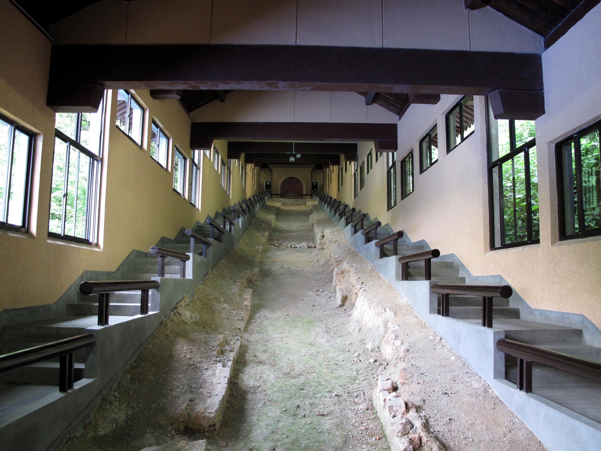

# 第 2 章 · 火的工程

## 2.1 三种形状

第一章剖析了一座窑场与一种名瓷所能达到的控制极限。本章则向后退一步，考察孕育这些陶瓷制品的物理核心热工装置：窑炉。

在中国数千年的陶瓷技术演进史中，曾涌现出数十种窑炉形制。本章选取三种最具代表性的窑型作为切入点，它们各自代表了截然不同的热工工程哲学：

- 依傍山坡顺势延伸的长隧道（龙窑）
- 平面近似圆形、横截面呈半球形拱顶的半密闭倒焰窑（馒头窑）
- 建于平地、形似仰卧禽卵的复合热工窑炉（景德镇镇窑，即蛋形窑）

三者的分野绝非仅在几何形貌，更在于对“如何令万千件陶瓷坯体在窑膛中稳定、均质地烧结至 1280°C 高温”这一热工命题给出的不同技术方案。本章循着时间脉络与地理分布，审视这三种工程方案的依次演进与技术互鉴。

## 2.2 龙窑：南方山坡上的隧道

龙窑滥觞于商代晚期至春秋战国，主要盛行于江南与东南丘陵地区，历经唐宋直至明清仍有沿用。其主体结构犹如一条依山构筑、顺坡爬升的修长隧道。考古勘探揭示出龙窑长度随时代的显著演变：早期（春秋战国）龙窑长度仅约 10 至 15 米；唐宋时期多稳定在 50 米左右；而在 2013 年江西**景德镇乐平接渡镇南窑遗址**的发掘中，揭露出一座中晚唐时期的超长龙窑，其总长达 78.8 米，为目前田野考古揭露的最长唐代龙窑标本 [^20] [^B1]。

南窑遗址展现了南方龙窑技术的规模化成熟。该窑场始烧于中唐，盛于中晚唐，衰于晚唐，距今逾千二百年。2013 年 3 月至 11 月的考古发掘揭示了龙窑遗迹 2 座、灰坑 10 处、灰沟 1 条及道路遗迹 1 条，累计揭露面积达 1013.5 平方米，出土窑具与瓷片标本数十吨。该座长达 78.8 米的龙窑北壁设有十三处投柴窑门，意味着窑工可分十三段沿坡逐步推移燃烧前沿。整个南窑遗址分布面积逾 3 万平方米，该发现荣膺 2013 年度全国十大考古新发现，有力地将景德镇地区的瓷器量产历史向前提早 [^B1]。

龙窑的构筑坡度通常保持在 10° 至 20° 之间。坡底为窑头（主燃烧室与点火口），坡顶则为窑尾（兼作排烟与抽力通道）。

> 图 2.1　杭州郊坛下南宋官窑遗址龙窑（长约 40 米、宽约 2 米）。窑体依山就势铺设，是南方“斜坡长隧道”热工构型的典型实物遗存。来源：G41rn8/Wikimedia Commons，CC BY-SA 4.0。

这种倾斜隧道构型并非审美产物，而是热工流体力学的必然选择。

受浮力驱动，热烟气自然趋向向上流动。将窑体构筑于斜坡之上，相当于利用地形高差形成了一座天然的巨型水平烟囱，构筑起由低至高的稳定热对流通道。窑头点火起烧后，炽热气流沿斜坡窑膛持续上涌，沿途预热后段坯体。窑工在窑体两侧拱券处每隔数米开设投柴孔（俗称“窑眼”），待低段窑温达到烧结阈值后，便沿坡依次向上一孔投入薪柴，推动燃烧高温带分段向上移动。

一座长达 50 米的成熟龙窑，单次装窑量可达数千至上万件。从点火升温至保温停烧，全程耗时约 20 至 30 小时。高温阶段投柴节奏极度密集，每隔 15 至 30 分钟即需加柴一次，整窑烧造需要多班窑工通宵达旦协同轮换。

### 龙窑的工程优势

其一，**自然对流与高热效率**。依靠斜坡高差形成强大抽力，无需复杂的机械鼓风设施。与同等有效容积的水平单室窑相比，其高温烟气对未烧坯体具有连续的梯级预热效应，显著降低了单位产出的燃料能耗。

其二，**极高的装载密度与量产规模**。单窑数千乃至上万件的吞吐能力，为民用陶瓷的规模化普及提供了决定性产能支撑。一炉窑火即可产出数千件规格统一的日用碗盘，是古代南方各大窑系（如越窑、龙泉窑、建窑）占领海内外大众市场的物质前提。

其三，**梯级温度场的综合利用**。自窑头至窑尾自然形成平缓的温度递减梯度：火膛核心区最高温可突破 1300°C，而尾段烟道处则降至 1100°C 左右。这种温区分布允许同一座窑炉实现混合装烧：将高温精细瓷器安置于前段，而将耐温较低的粗陶日用器置于尾段，实现了热能的最大化利用。

### 龙窑的工程局限

其最大缺陷在于**横截面与局部的温差波动**。在窑膛同一横断面上，近火侧与背火侧的温差常达数十摄氏度。窑工必须凭借代际传承的装窑排布经验，通过合理摆放匣钵与设置挡火柱来补偿流场的不均。

其二在于**对地形地貌的刚性依赖**。龙窑必须依附特定坡度的山脊或丘陵，在缺乏坡度的冲积平原上难以构筑。正因如此，龙窑广泛分布于浙江、福建、江西等南方丘陵地带；而一马平川的北方平原缺乏坡度支撑，催生了完全不同的热工设计思路。

其三在于**燃烧气氛波动较大**。龙窑修长的窑体与多处投柴孔容易引起外界冷空气漏入，窑内局部气氛常在氧化与还原之间摇摆。对于汝窑、南宋官窑等对极狭窄还原气氛有着极致要求的细瓷品类，龙窑控制难度极高，北方名窑遂普遍转向密闭性更高的窑型。

## 2.3 馒头窑：北方的圆顶

馒头窑因其剖面拱圆如馒头而得名。其技术雏形可溯至西周陶窑，主要分布于黄河流域及其以北地区，构成了定窑、钧窑、磁州窑、耀州窑及汝窑等北方各大窑场的核心热工设备 [^21]。典型馒头窑长约 2.7 米、宽约 4.2 米、窑室高逾 5 米，构成一个相对封闭的厚壁圆拱空间。

其热工逻辑与龙窑截然不同：龙窑依势顺流，馒头窑则利用半球形拱顶与倒焰吸力，强制高温烟气在密闭窑膛内完成充分的对流回旋后再经由排烟道逸出。

窑室前端设有下沉式燃烧室（火膛），燃料剧烈燃烧产生的炽热烟气首先腾升至窑顶，撞击穹顶后受阻向四周回旋扩散，再自上而下穿过密布的匣钵垛堆，最后由底部吸烟孔经由后壁双烟囱抽出。这种“倒焰循环”设计大幅消除了死角温差，窑膛内部的温度均质性远优于龙窑。

更为关键的是，厚重的耐火砖墙与可严密封堵的投煤口赋予了馒头窑优异的密闭性能，**使还原气氛得以精确调控**。窑工通过精准启闭排烟闸板与控制燃料投喂频率，能够将窑内氧分压稳定锁定在极窄区间。这正是北方烧制天青、月白、粉青等纯正还原色瓷器的热工基石。

馒头窑单窑装烧容量通常在数百件至千余件之间，体量虽逊于南方龙窑，但烧成温度可稳定维持在 1280°C 以上，成品合格率显著提升。

### 燃料格局的地理分野

龙窑主烧松柴，馒头窑多烧石炭（煤炭），这是受区域资源禀赋深刻制约的工程选择。

松木薪柴树脂充沛、挥发分高、燃烧火焰修长，极利于在龙窑狭长的隧道中推送热浪。然而松柴消耗体量惊人，单窑装烧常需耗费数吨至数十吨薪柴。南方江南丘陵植被繁茂，丰沛的马尾松林支撑了这种薪柴消耗。

相形之下，煤炭具有燃烧火焰较短、热值高度集中且燃烧持续稳定的物理属性，与馒头窑紧凑的回流空间高度契合。北方煤炭资源丰富，河南、河北、山西等地浅层煤炭的开采，为高温陶瓷烧造提供了充裕的燃料基础。

然而煤炭中普遍伴生硫化物杂质。若窑膛气氛控制不当，挥发性硫化物极易侵蚀釉面造成发暗。钧窑窑工在此展现了独特的工艺智慧：通过主动调控高硫煤烟气氛，配合铜氧化物在特定还原条件下的胶相沉降，创造出绚烂多姿的紫斑与红釉，将燃料杂质带来的不确定性转化为主观追求的视觉典范。

钧窑的工程实践展示了工艺探索的另一重面向：当特定化学变量难以完全消除时，通过工艺重构将其转化为独特的艺术语言，达成了技术控制与审美风格的统一。

## 2.4 镇窑：景德镇的蛋形革命

景德镇从早期龙窑走向成熟蛋形窑（镇窑），经历了数代热工革新。

**葫芦窑**是元末明初景德镇湖田窑等窑场首创的过渡形制 [^B2]。它融合了龙窑与圆窑的特征，平面呈前大后小的双联葫芦状，有效缩短了窑室长度，改善了过长窑膛难以精准控温控温的弊端。湖田窑遗址发掘中出土的元明时期窑炉遗迹清晰记录了这一演变轨迹。

至明末清初，葫芦窑进一步演化定型；**清乾隆年间，景德镇蛋形柴窑（即经典的“镇窑”）最终完全成熟** [^B3]。这一构型成为景德镇作为世界瓷都的核心物质象征。

镇窑整体形如一枚横卧的禽卵。典型窑身长约 18 米，前端最宽处约 6 米，拱券高约 5 米，窑膛有效容积达 160 至 200 立方米 [^22]。窑头迎风侧设大火膛，尾端耸立一座高逾十余米的圆锥形砖砌烟囱，中段为宽阔深邃的装烧空间。

这一构型堪称中国古代热工技术的集大成者：

- 兼具龙窑的**水平大体量容积**：单窑装烧量攀升至万件级别
- 具备馒头窑的**密闭控温与强抽力**：烟囱与后扬结构协同，气氛均质稳定
- **彻底摆脱地形坡度依赖**：可依水利码头在平原河谷上成排布局

### 容积演进：景德镇窑炉的体量曲线

镇窑容积的扩张直观映射着景德镇瓷业制造能力的跃迁。明代中后期，官窑单座窑炉容积仅约 5.25 立方米，同期民窑约 17.5 立方米；清康熙朝扩建至约 68 立方米；雍乾之际进一步增至 81 立方米；至清代中晚期，成熟蛋形大窑容积已达 160 至 180 立方米 [^22]。在两百余年间，单座工业反应器的容积扩容了三十余倍。

### 单座窑内的复合温区矩阵

镇窑最卓越的热工设计，在于**在单一大型窑膛内构筑出稳定的多温区梯级流场**。

火膛近处温度高达 1320°C，向烟囱方向逐级递减至窑尾约 1100°C。这一精密分布的温差格局，使得单座窑炉能够同时并线烧造多种工艺要求各异的瓷器：

- 前段高温区：装烧青花、釉里红、高温单色釉等需 1300°C 以上强还原气氛的顶级瓷品
- 中段均温区：装烧普通青白瓷、粉彩素胎与日用白瓷
- 尾段低温区：装烧薄胎器、粗瓷以及低温匣钵

一座成熟的景德镇大柴窑，单次出窑瓷器重达 10 至 15 吨（约 200 至 300 担），产能相当于明初官窑的数十倍之多 [^22]。单一热工装置兼容多条产品线，是古代前现代制造业实现柔性制造与规模经济的典范。

### 烧成周期的工序节奏

一座大型镇窑的烧成周期通常持续 30 至 40 小时：

- 前 6 小时（溜火期）：慢火烘烤，平稳升温至 800°C，排出坯体内残存结晶水以防崩裂
- 6 至 18 小时（紧火期）：自 800°C 快速拉升至 1100°C，开始调控入风量转入强还原气氛
- 18 至 24 小时（高温保温期）：在 1280°C 至 1320°C 高温段保持强还原气氛，令胎釉充分玻化熔融
- 24 至 36 小时（缓冷期）：封堵通风孔，使其缓慢冷却至 600°C 以释放结构热应力
- 36 小时之后：开窑散温，待降至常温后出窑拣选

期间窑工投柴频率由初期的半小时一次密集加速至高温期的每十分钟一次，单窑耗用优质松柴达十余吨之巨。

## 2.5 一座城的火与林

景德镇之所以能崛起为全球制瓷中心，除优质瓷土之外，还得益于周边广袤山系所产的高树脂马尾松。马尾松富含松脂，火焰温度高且少灰分，是柴窑最为理想的热能介质。景德镇所属的浮梁县，其古地名即取自“以溪水时泛，民多伐木为梁”之意，生动反映了当地借助昌江水系浮运木材的深厚传统 [^23]。

镇窑自明代中晚期盛行三百年，单窑装烧即耗柴十数吨。鼎盛时期，全城数十上百座窑炉日夜轮番点火，年耗松柴数十万吨之巨。即便迟至 1949 年后景德镇陶瓷工业恢复期，全行业年均木柴消耗量仍达 40 万立方米规模 [^24]。

如此庞大的木材吞吐量，对周边生态构成了持续的物质压力。浮梁、婺源、祁门乃至休宁等周边山区的森林被系统砍伐以供窑柴，柴运半径不断向内陆深山拓展。薪柴的采伐、顺流排运与陆路驳运成本，构成了瓷器生产成本的重要基底。

景德镇瓷业得以维持数百年的连续繁荣，部分归功于南方温润气候下马尾松林较强的自我更新能力；然而至清末民国，随着生态承载逼近极限与林木匮乏，柴价飞涨，传统柴窑体系逐渐难以为继，最终在二十世纪全面让位于煤窑、重油窑、气窑与电窑。

这是前现代大型工业体系与区域生态环境相互塑造的典型样本：维持一座世界级手工业都会的窑火不熄，本质上需要整片流域的林木水利网络作为物质后盾。

## 2.6 温度梯度作为工程资源

从原始龙窑的盲目顺应，到馒头窑的均温密闭，再到镇窑对温度梯度的系统驾驭，数百年间，中国窑工成功将“炉温分布不均”这一工程缺陷逆向转化为宝贵的工艺资源。

在早期龙窑中，窑内温差属于必须尽力平抑的干扰因素；而在成熟镇窑体系中，温差梯度演变为经过严密计算的工位矩阵：利用不同温区的热动力学特性，同步完成不同胎釉配方的烧成。

这种将物理不均质性转化为多任务处理能力的思路，与现代半导体制造中的阶梯退火炉、冶金工业中的连续退火生产线在工程原理上遥相呼应。在前现代技术条件下，景德镇窑工凭借对热流动力学的感悟与反复试错，实现了这一高度复杂的工程综合。

## 2.7 一座窑场的运转

一座运转中的大型窑场，绝非孤立的窑炉本体，而是一整套严密协同的建筑群落与劳动组织。

在明清景德镇的典型窑作坊中，空间按工序严格划分：

- 原料堆场：存放瓷石与高岭土原料
- 碓坊：依托水力水碓舂碎矿石
- 淘洗池与澄浆池：多级过滤与沉淀泥浆
- 釉房：研磨调配各类矿物釉浆
- 坯房：按器型划分的专业拉坯、利坯车间
- 施釉作坊：浸釉、吹釉与画坯装匣
- 窑房：窑炉本体与装窑码放作业区
- 选瓷房：出窑验货、分级剔除与残次销毁区

各个环节均由高度专业化的工匠负责：拉坯者不兼利坯，施釉者不事装匣，把桩师傅专司看火。流水线式的劳动分工在此已具完备雏形。

亚当·斯密在《国富论》（1776 年）中以欧洲制针工坊的十八道工序作为分工提高生产率的经典例证；而在十六世纪的景德镇，陶瓷制造已被系统解构为数十道、民间俗称“七十二道”的独立工序。

这种精细的分工体系，构成了下一章探讨的核心：窑炉奠定了前现代工业的物理热工基础，而工序分工则铸就了其组织管理底座。二者深度结合，方成其为人类历史上最早成熟的现代性工业制造系统。

---

## 参考文献

[^20]: 龙窑长度演变。商代晚期至春秋战国早期龙窑长度约 10–15 米；唐宋时期龙窑长度通常约 50 米。2013 年江西景德镇南窑发现唐代龙窑长 78 米，是目前已知最长的早期龙窑。维基百科条目"龙窑"https://zh.wikipedia.org/wiki/%E9%BE%99%E7%AA%91；2005 年中国十大考古新发现资料。

[^21]: 馒头窑形制与北方分布。馒头窑雏形出现于西周，主要分布于中国北方，是定窑、钧窑、磁州窑、汝窑等北方名窑的主要窑型。一般尺寸长约 2.7 米、宽约 4.2 米、高约 5 米以上。中国社会科学网《景德镇馒头窑及其技术源流》https://www.cssn.cn/kgxc/kgxc_kgxl/202302/t20230202_5585654.shtml

[^22]: 景德镇窑炉容积演进数据。明代官窑约 5.25 立方米，民窑约 17.5 立方米；清康熙约 68 立方米；清雍正乾隆约 81 立方米；清末蛋形窑成熟形态约 160–180 立方米；蛋形大柴窑容积约 160–200 立方米，单窑装日用小器 10–15 吨（约 200–300 担），是明代官窑产量的 40–60 倍。故宫博物院学术资源《明清景德镇瓷业发展与窑柴的应对》https://www.dpm.org.cn/Uploads/File/2024/09/09/u66de68767a89d.pdf

[^23]: 浮梁县名释义"以溪水时泛，民多伐木为梁"。维基百科"浮梁县"条目；湖南广电华声在线《景德镇的自古以来：浮梁烟火》https://m.voc.com.cn/xhn/news/201808/14549693.html

[^24]: 景德镇 1949 年后木柴年需求约 40 万立方米。引自景德镇陶瓷历代烧造窑炉编汇资料；参见故宫博物院学术资源出版物（同 [^22]）。

[^B1]: 景德镇南窑遗址 78.8 米唐代龙窑。江西省景德镇乐平市接渡镇，2013 年 3-11 月由江西省文物考古研究所等单位发掘，揭示龙窑 2 座、灰坑 10 个等，揭露面积 1013.5 平方米，出土窑具瓷片数十吨。78.8 米龙窑北壁有 13 处窑门。该遗址始烧于中唐、兴盛于中晚唐。入选 2013 年度中国十大考古新发现。中国考古《景德镇南窑发现唐代最长的龙窑遗址》http://kaogu.cssn.cn/zwb/xccz/201312/t20131216_3927962.shtml；中新网《景德镇发现唐代最长龙窑遗迹长达 78.8 米》https://www.chinanews.com.cn/tp/hd2011/2013/12-10/275315.shtml

[^B2]: 葫芦窑首创于元代景德镇，由龙窑演变而来，克服了龙窑过长难控制温度和气氛的问题。湖田窑（自五代至明代延续约 700 年）的考古发掘揭露了具有葫芦窑特征的元代窑炉。澎湃新闻《古窑址寻访②｜七百年窑火延续，"村村陶埏"是湖田》https://m.thepaper.cn/wifiKey_detail.jsp?contid=10592537&from=wifiKey；中国国家文物局《江西景德镇南窑唐代窑址》http://www.ncha.gov.cn/art/2022/5/25/art_2614_174514.html

[^B3]: 镇窑（蛋形窑）是明末清初景德镇开创、清代乾隆初年成熟的窑型，由龙窑、马蹄窑、葫芦窑的优点综合发展而来。一座窑一根烟囱，结构相对简单，适宜快烧快冷。百度百科"景德镇窑"条目 https://baike.baidu.com/item/%E6%99%AF%E5%BE%B7%E9%95%87%E7%AA%91/1687801

---

> 起稿：2026-04-27（第三稿，已加入考古实测与文献引用）
> 字数：约 5800
> 状态：2.1–2.7 完成。文献编号 [^20]–[^24] 已对照公开来源补全。下一稿可继续核查：龙窑燃料消耗对比水平窑的具体百分比；明清景德镇运转窑炉座数的精确数据；《浮梁县志》柴价记载原文。
