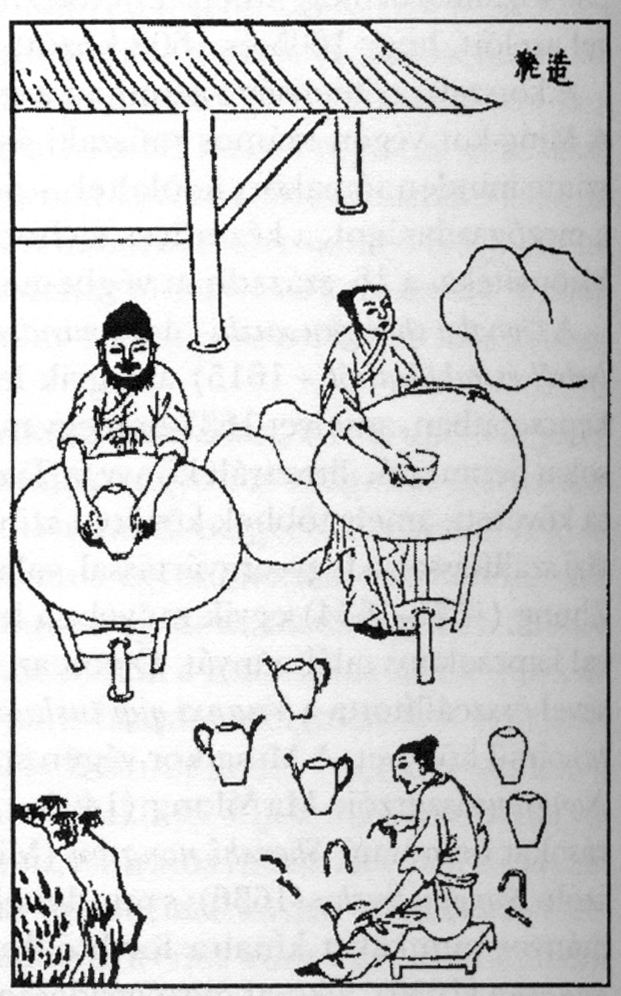

# 第 4 章 · 七十二道工序

> 图 4.1　《天工开物·陶埏》（明崇祯十年，1637 年初刊）所绘明代制瓷作坊场景。图中拉坯、修坯、画坯、入匣、烧造等各道工序在同一工坊内协同展开，是晚明景德镇精细分工作业的写实画卷。来源：Wikimedia Commons，公有领域。

## 4.1 一句话与一种工业组织

明末科学家宋应星（1587–1666 后）在《天工开物》（1637 年初刊）的《陶埏》篇中系统记述景德镇制瓷流程时，写下了一段精辟的工业论述：

> 共计一坯之力，过手七十二，方克成器。其中微细节目，尚不能尽也。
>
> （明 · 宋应星《天工开物·陶埏》[^25]）

所谓“七十二”，并非机械刻板的数字统计，而是极具中国传统特色的修辞概括，用以形容前现代手工业制造中分工之精细、流转之严密。历代文献对景德镇制瓷工序的梳理各有侧重：宋应星概言“七十二”；清代督陶官唐英在《陶冶图说》（1743）中系统归纳为二十道核心大纲；现代非物质文化遗产保护体系则将“景德镇手工制瓷技艺”细化为数百个互为衔接的微观工艺节点 [^26]。

本章的焦点不在于字面工序数字的繁简考辨，而在于探究：宋、元、明、清各时期的景德镇，究竟依托何种严密的劳动组织与协作网络，将“一团黏土”转化为“规格均一、品质稳定、成批出窑的高温瓷器”？

其核心答案，正在于高度专业化的分工制造体系。

亚当·斯密在《国富论》（1776 年）开篇论证分工与劳动生产率时，以欧洲制针工坊为例：一根铁针的制作被系统拆解为约十八道独立工序，每名工匠专司其职，从而创造出惊人的量产效率。斯密以此确立了分工理论作为现代工业经济基石的地位。

而在《国富论》问世两百余年之前，景德镇便已在远比铁针复杂得多的陶瓷复合制造体系中，确立了成熟精细的劳动分工制度。在欧亚大陆两端，关于“以精细分工驱动规模化制造”的工业实践与理论沉淀，在历史长河中构成了跨越时空的共鸣。

## 4.2 唐英：一个督陶官的制度建构

若要透视清代景德镇御窑分工体系的成熟运作，最具系统性与实录价值的文献来自清代督陶官唐英（1682–1756）[^27]。

唐英祖籍沈阳，汉军正白旗人，自青年起在内务府养心殿任职，谙熟宫廷营造规制。雍正六年（1728），四十六岁的唐英受命以“协理官”身份派驻景德镇，协助督陶官年希尧整饬御窑厂事务 [^A7]。初抵景德镇时，唐英对陶瓷热工与成型工艺尚无实践经验，其受命督陶纯属内务府高级官员的行政指派。

据其自述（《陶冶图说》序及《陶人心语》），唐英驻厂之初与底层陶工同席共榻、朝夕切磋，虚心向一线老匠人求教选料、拉坯、施釉与把桩火候之法，历经数载磨砺，由初涉陶政的门外汉成长为通晓制瓷全流程的工艺管理大师 [^28]。

唐英与年希尧共同开创了雍正朝御窑的辉煌期。年希尧（？–1739，汉军镶黄旗）自雍正四年（1726）起以督理淮安关税兼管陶政，世称“年窑” [^A7]。在此期间，年希尧主管钱粮调拨与贡品解送，而一线工序监管、原料试验与质量控制则由唐英全权主持。乾隆二年（1737），唐英奉命兼领九江关税并正式总领景德镇御器厂陶务。自 1728 年协理至 1756 年卒于任上，唐英督理景德镇御窑前后近三十载，历经雍乾两朝盛世，成为中国陶瓷史上履职最久、建树最卓著的工业管理者 [^27] [^A7]。

唐英在任期间的最大贡献，不仅在于保障了数以万计宫廷御瓷的高品质烧造，更在于将长期依托口传心授的非结构化经验，完成了全面的文献化、图谱化与制度化沉淀。他先后编撰《陶务叙略》《陶冶图说》《陶成纪事》《瓷务事宜谕稿》等著作 [^A7]。《陶冶图说》是中国历史上首部完整、系统解析景德镇制瓷工艺链条的图文专著；而《陶成纪事》则系统总结了五十七种名贵色釉与彩瓷配方（涵盖仿宋古名窑、明代各朝官窑及西洋引进彩料），堪称十八世纪中国御窑制造能力的最高技术清单。

在唐英之前，关于瓷器制作的文字记载多零星散见于《天工开物》或地方志乘，缺乏端到端工序流程的严谨贯通。唐英的工作，第一次以前现代工程师和高级职业经理人的视野，将复杂的陶瓷生产还原为一个闭环自洽的现代工序流水系统。

## 4.3 《陶冶图说》：二十图与工业系统的图谱化

乾隆八年（1743），清廷造办处将内府珍藏的二十幅描绘景德镇制瓷工序的图卷交付时年六十二岁的唐英，命其依生产时序重新编排次序并详加考订作注，此即流芳后世的《陶冶图说》（亦称《陶冶图编次》）[^29]。

这二十幅图谱依生产逻辑环环相扣，完整呈现了十八世纪世界顶级陶瓷基地的工艺全景：

1. **采石制泥**：自山峦开采优质瓷石与高岭土，水碓舂打与初级洗选
2. **淘炼泥土**：多级沉淀池除杂，精细过筛，泥浆陈腐
3. **炼灰配釉**：煅烧石灰石与凤尾草灰，水磨精炼，调配高温基础釉浆
4. **制造匣钵**：以耐火黏土拉坯制作耐火匣钵，烘干备用
5. **圆器修模**：制作碗盘等旋转对称器型的精密定型内模
6. **圆器拉坯**：陶车飞旋，工匠以手法拉出圆器粗坯
7. **琢器做坯**：雕塑拼接瓶、尊、罐等非旋转对称复杂异形器
8. **采取青料**：勘采与选购天然含钴矿物颜料
9. **炼选青料**：煅烧提纯青料，乳钵精细研磨成墨汁状浆料
10. **印坯乳料**：利用定型模具压印修整生坯尺寸，同步研磨各色彩料
11. **圆器青花**：青花画师在圆器素坯上以钴料勾线分水
12. **制画琢器**：在异形琢器素坯上绘制复杂山水、花鸟及人物纹样
13. **蘸釉吹釉**：针对不同器型分别采用浸釉、蘸釉、浇釉或吹釉工艺
14. **旋坯挖足**：将带釉干坯固定于木旋盘上，旋削规整圈足与底款位置
15. **成坯入窑**：将施釉干坯装入专用匣钵，分层码放挑运入窑
16. **烧坯开窑**：封门点火，依升温曲线投柴控火，烧毕缓冷出窑
17. **圆琢洋采**：在烧成的白瓷釉面上敷施洋彩、珐琅彩与五彩纹样
18. **明炉暗炉**：利用低温烤花彩炉（明炉或暗炉）固化釉上彩料
19. **束草装桶**：以稻草捆扎防护，装入木桶篾篓，准备水陆发运
20. **祀神酬原**：祭祀风火仙师，结算匠人工资，核算物料损耗与年度账目

上述二十道乃是统领全局的**主干工序**。在具体车间运作中，每道大工序内部又衍生出多层细分工种。以“圆器拉坯”为例，实际包含运泥工、打杂工、打坯工、印坯工、利坯工、荡釉工等数个专业化岗位的高效流水接力 [^26]。全流程各环节相互嵌套，累计参与人员与操作节点实远超二十道大类，此即宋应星所谓“过手七十二”的真实工业背景。

## 4.4 工业组织的空间与功能剖面

将《陶冶图说》所载规程置于现代工业工程框架中剖析，它清晰展现出前现代巨型制造工坊的职能切分：

### 资源与原料端（上游）

- 采矿与水动力粉碎（采石制泥）
- 分级选矿与沉淀均质化（淘炼泥土）
- 耐火材料与消耗品制造（制造匣钵）
- 釉用熔剂与着色剂提纯（炼灰配釉、炼选青料）

这是整个工业制造体系的**资源端**，奠定了终端制品的物质与理化基础。

### 精密成型与冷加工端（中游）

- 模具开发与型准控制（圆器修模）
- 坯体成型与手工旋削（拉坯、做坯、印坯、利坯、挖足）
- 釉下彩绘与图案标准化（圆器青花、制画琢器）
- 界面涂层施加（蘸釉、吹釉）

这是整个工业制造体系的**加工端**，分工最繁、工序最密。一件高档瓷器在入窑前需经数十道不同工匠指掌流转，各工位公差控制直接关乎最终形貌。

### 高温热工反应端（核心热工）

- 炉膛装载与装匣排布（成坯入窑）
- 气氛与热工制度控制（烧坯控温）
- 降温相变与出炉分级（开窑拣选）

这是整个制造链条中的**核心热工瓶颈**，直接决定成千上万件坯体在高温下的最终成败。

### 表面精饰与供应链交付端（下游）

- 釉上复合彩绘与低温烘烤（圆琢洋采、明炉暗炉）
- 缓冲包装与发运集港（束草装桶）

这是工业链条的**终端处理与交付环节**，直接关乎成品的视觉呈现与长途物流安全。

### 治理与组织保障层（运营支撑）

- 生产仪式化凝聚与会计清算（祀神酬原）

这一环节深具组织社会学意义：既通过“祭祀风火仙师童宾”强化了行业共同体认同与安全敬畏，又通过“酬原”严格实施年度工钱结算、奖惩考核与成本摊派。前现代工业组织将精神治理与财务核算紧密结合，构筑起稳固的人力协作网络。

## 4.5 一生专司一职：技能深度与组织刚性

在明清景德镇的专业化分工体系中，绝大多数工匠一生专注于单一工种：

拉坯师傅终生不事施釉，荡釉工匠不入窑膛看火，青花画师不画粉彩，描线匠人不司填色，写款师傅专事底足落款。各工种皆需经数年乃至数十年的严格学徒训练方能达标。

这一模式与现代装配流水线具有相同的分工逻辑，但在技艺属性上展现出鲜明区别：

- 现代自动化流水线：工序动作高度分解与去技能化，岗位易于被机械或低技能劳动力迅速替换
- 前现代景德镇分工：工序高度拆解的同时，各环节仍高度依赖工匠个人的**感知经验与非编码化隐性知识**

例如“利坯”工序（将拉坯成型的粗坯旋削至均匀一致的标准厚度），需要工匠完全依托指尖触感感知坯体微观厚薄。熟练利坯师仅凭刀尖传来的微弱阻力与敲击声音，便能将厚度公差精确控制在毫米级。这种内化于身体经验的肌肉记忆，构成了前现代品质控制的核心。

这构成了**手工时代前现代工业的独特形态**：分工高度细化，但各工序的公差控制仍深度依托于熟练匠人的肌肉记忆与心手相印。这种机制保障了景德镇瓷器无与伦比的工艺水准，但也在客观上形成了对熟练工匠群体的高度依赖。

## 4.6 景德镇工艺文献的三级演进

景德镇制瓷技术的文献留存，呈现出清晰的学术与历史演进层级：

**第一层级：一线学者的实地观察与物质记录**

明末宋应星所著《天工开物·陶埏》（1637），代表了士大夫学者深入生产车间的一线实录。宋应星在江西任教谕期间详加考察，用平实精练的文笔首次记录了明代景德镇分工作业与窑炉实况，成为研究晚明手工业技术的奠基文献 [^25] [^30]。

**第二层级：职业技术官僚的系统化流程再造**

清代唐英所撰《陶冶图说》（1743），代表了高级管理者的系统梳理。唐英以督陶官的全局视野，按生产时序将全流程编排为标准化图册，强调工序交接的闭环与可追溯性，成为中国首部具有现代工程流程图性质的制瓷巨著 [^29]。

**第三层级：地方史家的宏观典籍集成**

清代蓝浦原著、郑廷桂补辑的《景德镇陶录》（嘉庆二十年，1815 刊行），则代表了集大成的历史学与地方志总结。全书梳理历代沿革、窑口变迁、规制掌故与名匠谱系，成为近代以来全球学者研究景德镇通史的核心参考典籍。

从《陶埏》的直观白描，到《陶冶图说》的流程建构，再到《景德镇陶录》的历史总括，历经近两百年的文献沉淀，景德镇瓷业完成了从“被感性记录的手艺”向“被系统化治理的工业制造体系”的认知飞跃，这本身即是其工业化深度的重要标志。

## 4.7 分工深化与前现代工业范式

重审亚当·斯密在《国富论》中总结的分工三大效益：提高劳动熟练度、节省工序转换时间、促进专用工具研发。

景德镇的瓷业实践对这三项原理提供了完美的实证：

- **专业技能的代际精进**：工匠一生专司一职，使拉坯、剔花、利坯之术臻于化境
- **流转成本的大幅降低**：工位固定排列，生坯顺着滑板、木架在各工序间无缝传递，杜绝了跨工位走动的无效耗时
- **专用工具的系统演进**：拉坯车、利坯刀、青花画笔、吹釉竹筒、定型印模及耐火匣钵等，形态高度专门化

斯密所描述的是十八世纪英国工业革命前夕的小型手工工场；而景德镇早在十六世纪，便已在横跨数十平方公里的城市空间内，以数十万产业人口的协同规模，实现了极为精密的超大规模分工。

当然，必须清醒指出：分工的成熟并不等同于工业革命。工业革命的本质跃迁不仅在于分工模式，更在于**化石能源与机械动力的系统性引入**（如蒸汽机动力、传动机械与可替代人力的精密机床）。明清景德镇始终立足于水力与人力驱动的手工分工体系，尚未跨越至机械化量产阶段。

从工业技术史的维度审视，景德镇堪称“前现代手工工业的最高范式”：在缺乏外加机械动力的历史条件下，它将劳动分工、品控制度、热工集成与规模化量产的能力推演到了前现代文明所能达到的极致水准。

在下一章中，我们将离开具体的车间工序，审视更宏观的制度维度：探究官窑与民窑并行的二元体制，如何在同一座城市中相互博弈、彼此滋养，共同支撑起千年不熄的瓷都命脉。

---

## 参考文献

[^25]: 宋应星.《天工开物·陶埏》. 明崇祯十年（1637）初刊。维基百科条目"天工开物" https://zh.wikipedia.org/wiki/%E5%A4%A9%E5%B7%A5%E5%BC%80%E7%89%A9

[^26]: 中国非物质文化遗产网"景德镇手工制瓷技艺"项目档案. https://www.ihchina.cn/project_details/14270/

[^27]: 维基百科"唐英（清朝督陶官）" https://zh.wikipedia.org/zh-cn/%E5%94%90%E8%8B%B1_(%E6%B8%85%E6%9C%9D%E7%9D%A3%E9%99%B6%E5%AE%98)

[^28]: 唐英自述与同代记载。综述见知乎专栏《千年御窑史，唐英第一人！》https://zhuanlan.zhihu.com/p/43864846；GLOSSARY: Tang Ying (1682–1756), https://www.gotheborg.com/glossary/tangying.shtml

[^29]: 《陶冶图说》（亦称《陶冶图编次》）, 乾隆八年（1743）唐英奉旨编撰。Twenty Illustrations of the Manufacture of Porcelain by Tang Ying, https://gotheborg.com/twentyillustrations/tangying16.shtml

[^30]: 宋应星生平与《天工开物》成书背景. 中国作家网《〈天工开物〉：中国十七世纪的工艺百科全书》. https://www.chinawriter.com.cn/n1/2022/1128/c442005-32575805.html

[^A7]: 唐英 (1682-1756) 与年希尧的督陶官接替关系. 唐英祖籍沈阳, 汉军正白旗, 1728 年雍正六年作为协理官派往景德镇协助年希尧; 1736 年乾隆元年年希尧因庇恶纵贪被革职; 1737 年乾隆二年唐英奉命复办陶务兼领景德镇御窑厂; 在任与协理总计约 27 年, 跨雍正乾隆两朝。年希尧 (?-1739) 籍贯安徽怀远, 汉军镶黄旗, 雍正四年 (1726) 督理淮安板闸关兼管景德镇御窑厂, 世称"年窑"。唐英著作包括《陶务叙略》《陶冶图说》《陶成纪事》《瓷务事宜谕稿》《陶人心语》;《陶成纪事》记录 57 种釉色品种。澎湃新闻《"史上最牛"督陶官：唐英》https://www.thepaper.cn/newsDetail_forward_1869245；知乎《中国四大督陶官！读懂了他们也就读懂了清代陶瓷史！》https://zhuanlan.zhihu.com/p/92626530；维基百科"唐英 (清朝督陶官)" https://zh.wikipedia.org/zh-cn/%E5%94%90%E8%8B%B1_(%E6%B8%85%E6%9C%9D%E7%9D%A3%E9%99%B6%E5%AE%98)

---

> 起稿：2026-04-27
> 字数：约 5800
> 状态：4.1–4.7 完成。文献编号 [^25]–[^30] 已对照公开来源补全。下一稿可继续核查：景德镇陶录蓝浦的具体生卒和成书过程；明代景德镇工种数量的精确统计；唐英《陶成纪事》中工序记载与《陶冶图说》的差异。
