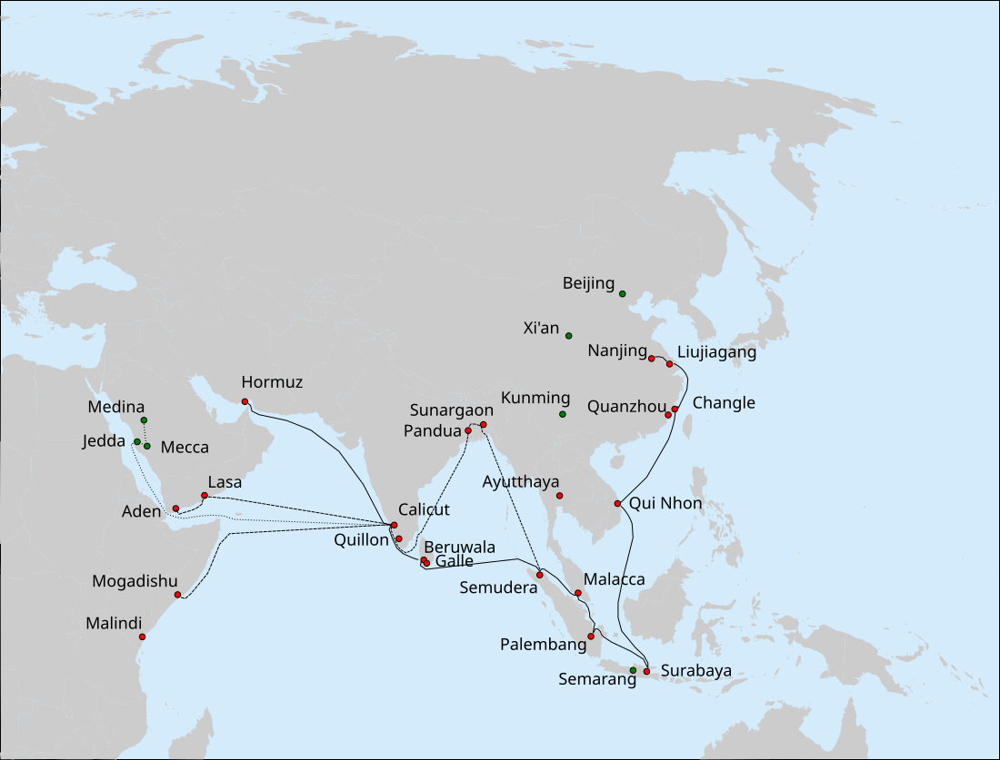

# 第 8 章 · 漕运与海运

## 8.1 一座内陆都会的全球物流网络

从传统地理区位审视，景德镇的地理禀赋看似并不利于大规模长途商贸：地处江西省东北部、赣皖两省交界的崇山峻岭与丘陵盆地之间，距最近的沿海大港（宁波、泉州、广州）皆有千里之遥。

然而在明清两代，这座内陆山城却一跃成为人类历史上吞吐量最大的全球商品制造与输出中心：数以亿计的高温瓷器自昌江码头解缆起运，经鄱阳湖汇入长江干流，或溯江而上深入腹地，或顺流出海转运至广州、泉州、厦门、月港等外贸深水港，最终铺展至果阿、巴达维亚、马尼拉、阿姆斯特丹、伦敦、墨西哥城与波士顿的餐桌与博古架之上。

将深山盆地的生产原点与横跨重洋的全球网络有机缝合的，正是中国前现代高度发达的两大航运基础设施：**内河漕运网络**与**跨洋海上贸易航线**。本章将解构这一贯通内陆与大洋的水运物流体系。

## 8.2 昌江：陶瓷工业动脉的“第一公里”

景德镇依昌江而建、因昌江而兴 [^44]。昌江发源于安徽祁门南麓，蜿蜒南流纵贯景德镇全境，于波阳县注入鄱阳湖，构成景德镇对接外部水系的唯一主干水道。

对于景德镇的瓷业系统而言，昌江承担了三重不可替代的枢纽功能：

其一，**矿物原料的汇聚廊道**：浮梁三龙、瑶里、高岭山等周边矿区开采的瓷石与高岭土，经东河、西河、南河等昌江支流，依托浅水驳船源源不断运抵镇区沿河各大原料码头，实现了方圆百里内原材料向制造核心区的低成本集聚。

其二，**窑用薪柴的漂运网络**：明清镇窑消耗的巨量松柴，多采伐自皖南休宁、祁门及赣北婺源深山。山民将粗大松木扎成木排，趁春夏溪水暴涨之机顺昌江顺流放漂至景德镇。“以溪水时泛，民多伐木为梁”（浮梁古县名之由，参见第 2 章 2.5 节）生动再现了这一借水运柴的历史图景。

其三，**制成品出山的水运起点**：出窑检验合格的成箱瓷器，在镇内码头装载入吃水较浅的“昌江驳船”，顺水南下直达鄱阳湖口。

昌江虽属中小型山溪性河流，但作为景德镇庞大工业生态链的物料输入与成品输出咽喉，其战略地位无可替代。

## 8.3 鄱阳湖与长江：接入帝国黄金水道

装载瓷器的货船自昌江驶入鄱阳湖（中国第一大淡水湖），穿湖而过，于湖口重镇汇入滚滚长江。一旦进入长江干流，景德镇瓷器便彻底接入了中国前现代运力最宏大、辐射最广袤的水运干线。

长江的东西向流向，确立了景德镇瓷器国内流通的两大核心矢量：

- **顺流东下航线**：过九江、安庆、南京、镇江、扬州、苏州，直达松江与上海，深度覆盖江南市镇消费市场；或于长江口换装海船北上海东（日本、朝鲜），或南下闽粤集港出洋
- **逆流西上航线**：溯江穿过武昌、荆州、宜昌，穿越三峡直达重庆、成都，系统辐射华中与大西南内陆大市场

这两条依托长江干流的干线物流，构筑了明清景德镇瓷器通达全国腹地的经济命脉。

## 8.4 京杭大运河：御瓷进京的国家漕运走廊

景德镇御器厂烧造的官窑瓷器，其最终交付目的地为北京紫禁城。这一横跨两千余里的国家级特种物流，依托的是古代世界上最宏大的人工运河体系：京杭大运河。

其具体的漕运路线如下：

```
景德镇码头（装船）→ 昌江顺流 → 鄱阳湖水道 → 九江湖口
               → 沿长江干流顺流东下至镇江/瓜洲渡口
               → 换装漕船进入京杭大运河扬州段
               → 沿运河一路北上（经淮安、徐州、临清、沧州）
               → 抵达通州张家湾码头 → 陆路短驳进紫禁城内务府
```

京杭大运河纵贯南北约千八百公里，明清两代迎来了运河运营的极盛期，承担了全国大宗物资调配的枢纽功能 [^45]。御窑官瓷作为国家专办物资，列入皇家漕运序列，由工部委派的监运官押运，实行专船装载、挂牌放行，严禁与民间杂货混装夹带。

在漫长水运中，特种防震包装是确保易碎品完好率的核心技术：出窑御瓷先以优质软稻草逐件严密裹扎，再以十件或数十件为一组紧密捆扎，装入特制杉木箱或篾篓之中，缝隙以谷糠、纸屑及水油纸严密封灌填实。整船航行自景德镇至北京通州，视水情汛期通常需历时一至三个月。

官瓷长途漕运的损耗风险极高，江淮风浪与运河搁浅事故在清代内务府档案中屡见不鲜。凡遇沉船覆舟，押运官员须详尽具折上奏核销。这导致御用官瓷的实际落地成本呈倍数级攀升：一件在景德镇烧造工本仅数两白银的精细瓷器，经长途押运抵京后，分摊运费与损耗后的综合成本常高达数倍。

## 8.5 跨洋海运：从江河走向全球大洋

景德镇外销瓷进入全球贸易网络的主流航线体系如下：

```
景德镇 → 昌江 → 鄱阳湖 → 长江
       → 长江口集港，或经浙东运河/赣江陆岭古道
       → 分流南下至主要出海港：泉州 / 漳州月港 / 广州黄埔港
       → 换装吃水深沉的远洋商船，驶入全球远洋主航线
```

不同历史时期的枢纽海港演变，深刻反映出国家贸易政策与地缘格局的变迁：

- **宋元时期（刺桐时代）**：福建泉州港（东方第一大港）为主要出口口岸，景德镇青白瓷与龙泉青瓷经此扬帆，远销东南亚、南亚次大陆、波斯湾与东非沿岸
- **明代早期（官方朝贡航运）**：虽有海禁政策压制民间走私，但永乐至宣德年间由朝廷主导的**郑和七下西洋**（1405–1433），派遣规模宏大的官方船队，将数以十万计的景德镇早期青花与彩瓷作为国家礼品与贸易物资，系统输往爪哇、苏门答腊、古里、忽鲁谟斯（波斯湾口）、阿丹（亚丁）乃至东非木骨都束等三十余国，极大地开拓了亚非海岸对中国青花瓷的持续需求 [^A10]
- **明中后期（月港与大帆船贸易）**：福建漳州月港开海，漳州与景德镇外销青花大盘大规模装载于西班牙“马尼拉大帆船”，经太平洋航线横渡至墨西哥阿卡普尔科，进而转运欧洲



> 图 8.1　郑和第七次下西洋（1431–1433）干线与分队航迹。庞大的宝船舰队将景德镇青花瓷器作为核心贸易物资，成体系输往印度洋与红海沿岸诸国。来源：Vmenkov/Wikimedia Commons，CC BY-SA 3.0。

- **清代（广州一口通商时代）**：乾隆二十二年（1757）至道光二十二年（1842）实行广州单口对外贸易体制，景德镇外销瓷统一经赣江上溯至赣州，翻越梅岭古道（大庾岭）挑运至北江，顺流直达广州十三行，再经由英国东印度公司、荷兰东印度公司及美国“中国皇后号”等远洋帆船运往欧美各大港口

海港重心的每一次空间迁徙，皆深刻联动着景德镇民窑生产格局与装饰样式的调整。

## 8.6 物流加成与前现代全球贸易定价机制

解析一件十七至十八世纪景德镇青花瓷在欧洲终端市场的价值构成，可清晰透视前现代长途贸易的经济学规律：

- **出厂制造成本**：景德镇民窑烧造成型一件标准克拉克青花盘，工料成本仅折合数分至数钱白银
- **国内驳运成本**：自景德镇水陆兼程转运至广州十三行货栈，叠加关税与短驳费用，货价翻倍
- **远洋航运成本**：荷兰或英国武装商船历经好望角万余海里惊涛骇浪，承担风暴沉船与海盗风险，到岸货价加成可达 5 至 10 倍
- **欧洲分销与拍卖加价**：经由阿姆斯特丹或伦敦拍卖行分级竞价、批发商周转及奢侈品金银包镶精饰，终端零售价较景德镇出窑成本常暴增 **20 至 50 倍**

这一成本结构的悬殊反差揭示出前现代跨洋贸易的核心规律：**在漫长的高风险物理运输条件下，物流成本与流通溢价构成了终端商品价格的主导决定力量**，其权重远超原材料与生产车间制造成本。

这一经济学现实亦深刻解释了十八世纪欧洲本土制瓷业的崛起动因：一旦德国迈森（1710）与英国韦奇伍德（1759）成功破译高温瓷器配方，欧洲本土工厂省去了逾八成的跨洋运输与关税成本，中国外销瓷的垄断性市场份额遂不可逆转地被本土工业产能所替代。

## 8.7 双向物资流动中的文化与信息拓扑

跨洋航运绝非单纯的单向物质输出，它同时构筑了一条高频互动的跨文化信息反馈通道。

明清两代伴随瓷器外销而输出的，是西方世界对中华文明的整体视觉建构。万历至乾隆两百余年间，欧洲宫廷与启蒙知识分子对东方秩序的向往，很大程度上依托景德镇瓷器表面的亭台楼阁、文人雅士与山水清气作为具象媒介。

与此同时，逆向的信息流动亦深度重塑了景德镇的车间实践：欧洲贵族定制的家族纹章图样、油画版画稿本、西洋钟表与咖啡具器型，经由十三行外商订单源源不断反哺于景德镇作坊。中国瓷工迅速掌握了西洋焦点透视、花体英文字母与洛可可卷草纹样的装饰技法，孕育出兼容中西的“广彩”与清代官窑洋彩艺术。

在下一章中，我们将聚焦大航海时代第一款真正意义上的全球贸易硬通货：深度剖析“克拉克瓷”如何在欧亚各大洲间掀起席卷世界的青花风暴。

---

## 参考文献

[^44]: 昌江发源于安徽祁门，向南流经景德镇汇入鄱阳湖，是景德镇水运体系的主干。1984 年航道渠化整治后 300 吨级船舶可经鄱阳湖直通长江。百度百科"昌江"条目 https://baike.baidu.com/item/%E6%98%8C%E6%B1%9F/2661438；江南都市报《海上丝绸之路上的景德镇外销瓷》https://jndsb.jxnews.com.cn/system/2023/11/25/020311118.shtml

[^45]: 明清两代京杭大运河货运量约占全国 3/4。维基百科"京杭大运河"条目 https://zh.wikipedia.org/zh-cn/%E4%BA%AC%E6%9D%AD%E5%A4%A7%E8%BF%90%E6%B2%B3；广州市政协《文史漫步·明清漕运的经济账》https://www.gzszx.gov.cn/wstd/wsmb/32884.shtml

[^A10]: 郑和下西洋七次航行年代与航程。永乐三年（1405）至宣德八年（1433），前后 28 年共七次。航程经东海、南海、马六甲海峡、安达曼海、孟加拉湾、阿拉伯海、波斯湾、亚丁湾、红海，到达爪哇、苏门答腊、暹罗、古里、阿丹、忽鲁谟斯、木骨都束（今索马里）、莫桑比克贝拉港等 30 多个国家和岛屿。携带瓷器、丝绸、漆器等中国物产。维基百科"郑和下西洋"条目 https://zh.wikipedia.org/wiki/%E9%83%91%E5%92%8C%E4%B8%8B%E8%A5%BF%E6%B4%8B

---

> 起稿：2026-04-27
> 字数：约 4000
> 状态：8.1–8.7 完成。文献编号 [^44]–[^45] 已对照公开来源补全。下一稿可继续核查：景德镇至北京漕运的具体时间和成本数据；郑和下西洋携带的瓷器数量与种类；明清海港转移的具体政策时间线。
