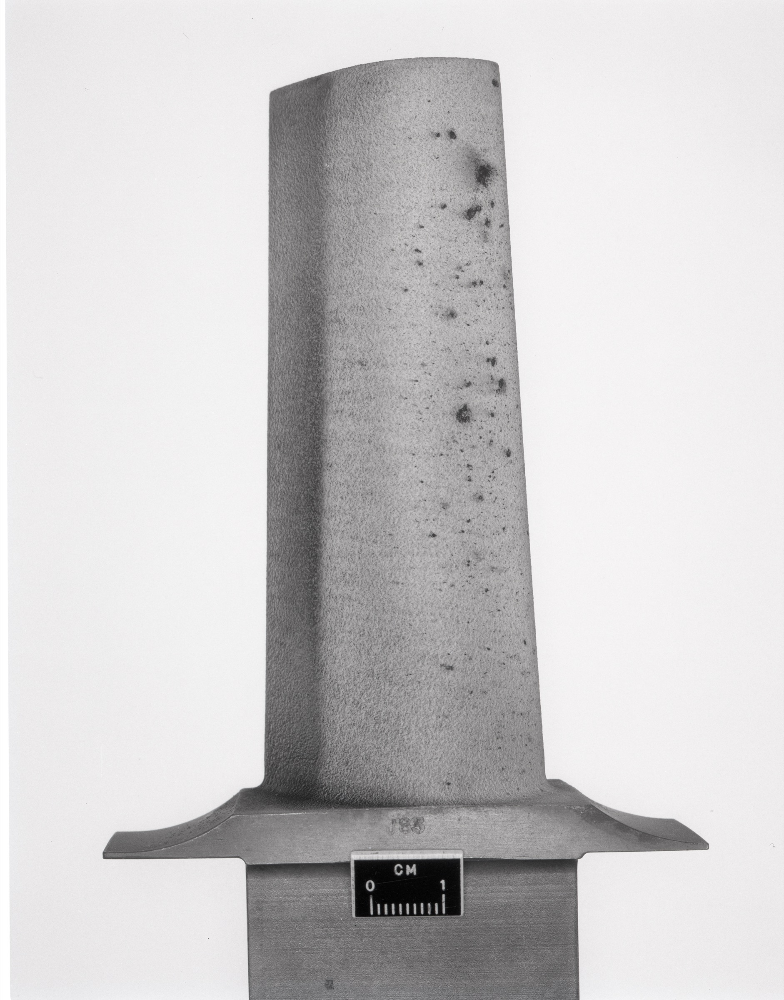

# 第 12 章 · 当代先进陶瓷工程

> 图 12.1　NASA 路易斯研究中心（今格伦研究中心）1974 年研发的陶瓷涡轮叶片，是现代陶瓷基复合材料（CMC）在航空航天领域应用的早期原型。它与宋代汝窑、明代青花在无机材料本质上一脉相承：皆是通过高温热工使无机矿物粉体完成固相/液相烧结、转化为致密多晶相。来源：美国国家档案馆 NARA 17419464 / NASA，公有领域。

## 12.1 隐匿于尖端制造中的无机材料基石

在当代高精尖工业制造的核心版图中，几类最具代表性的极端装备：航空发动机的高温涡轮叶片、极紫外（EUV）光刻机的真空工件台与反射镜、人体全髋关节置换假体，以及智能移动终端的射频滤波器与声学传感器，其核心构件皆深度依托高性能先进陶瓷材料。

这些材料早已超越了陈设器皿的范畴，升华为严苛工况下的高可靠性结构与功能材料。从凝聚态物理与无机非金属材料学的视阈审视，它们与北宋汝瓷、明代青花、清代珐琅彩在物质本质上遵循着相同的科学规律：通过精确控制无机微细粉体的化学配比与高温烧结动力学过程，使之转化为兼具致密晶相与特定界面的多晶体复合结构。二者的本质差异，在于现代工程学将纯度控制、几何公差与相变调控推向了前所未有的微观尺度。

本章将系统剖析二十一世纪先进陶瓷的技术谱系，并将其与前述各章所探讨的中国传统陶瓷工程进行理论溯源与范式比对，揭示跨越千年的材料演化脉络。

## 12.2 航空航天：连续纤维增强陶瓷基复合材料（CMC）

现代高性能航空发动机的燃烧室核心温度已突破 1700°C，远超各类金属镍基单晶高温合金的理论承温极限（通常低于 1150°C，过高温度将导致金属晶界滑移与蠕变断裂）。

突破热障极限的关键战略材料，正是**连续纤维增强陶瓷基复合材料**（Ceramic Matrix Composites，简称 CMC）[^52]。

CMC 的典型微观构型包含两大核心要素：以耐高温碳化硅（SiC）或氮化硅（Si₃N₄）作为陶瓷基体，以连续碳化硅陶瓷纤维束编织网作为增强相。二者通过化学气相渗透（CVI）或先驱体浸渍裂解（PIP）工艺复合，既保留了陶瓷材料极高的耐热性与化学惰性，又依托纤维桥联与界面脱粘机制彻底克服了传统单相陶瓷易脆断的致命缺陷：

- **极低的材料密度**：密度仅约 2.5 至 3.0 g/cm³，仅为传统镍基高温合金的 **三分之一**
- **极限耐温能力**：工作耐受温度较先进单晶合金提高 150°C 至 350°C，显著降低了高压冷却空气消耗
- **优异的高温强度与抗蠕变性**：在高温环境下的结构刚度表现出色

在现代航空动力领域的应用层级分布：

- **中温（700°C–1000°C）静止构件**：燃烧室机匣、排气喷管调节片
- **高温（1000°C–1300°C）静止构件**：燃烧室火焰筒、涡轮外环、高压涡轮导向叶片
- **超高温高负荷旋转构件**：高压涡轮转子叶片与一体化 CMC 涡轮盘，需承受每分钟数万转带来的巨大离心拉应力

通用电气航空（GE Aerospace）已在 LEAP 系列及 GE9X 商业大涵道比发动机中，成体系导入了 CMC 燃烧室衬套与高压涡轮导向叶片 [^52]，实现了整机显著减重与热效率跃升。

中国在新一代航空动力陶瓷材料领域亦取得重大技术突破：2024 年实现全国产陶瓷基复合材料整体涡轮盘成功首飞，为第六代高性能航空发动机奠定了关键材料基础 [^53]。

重审这一前沿工程实践：北宋汝窑工匠在十二世纪将胎釉铁钛杂质控制在 1% 容差内，依托还原焰实现青翠釉色；当代材料科学家则在纳米尺度精准调控碳化硅纤维微观晶界、热解碳界面相厚度与烧结致密度。**二者在工艺哲学上高度契合：皆是通过严密约束材料的微观物理化学状态，以确保宏观性能的极致稳定**。

## 12.3 半导体与集成电路装备：超高纯电子与结构陶瓷

超大规模集成电路制造装备对先进陶瓷材料形成了极高的工程依赖：

**其一：前道晶圆制造关键工艺腔体结构件**

在光刻机、等离子刻蚀机及化学气相沉积（CVD）设备中，构件须在超高真空、强腐蚀等离子体与高频电磁场环境下保持长期尺寸稳定：

- **高纯氧化铝（Al₂O₃）陶瓷**：作为等离子刻蚀腔体内衬、绝缘环与晶圆机械手臂，具备极佳的耐等离子冲刷性能
- **高热导氮化铝（AlN）陶瓷**：室温热导率高达 170 至 200 W/(m·K)，热膨胀系数与硅单晶完美匹配，广泛用于大功率功率半导体模块（IGBT）的直接覆铜绝缘基板（DBC/AMB）与加热吸盘
- **高强韧氮化硅（Si₃N₄）陶瓷**：抗弯强度高、耐摩擦磨损，用于超精密空气轴承与晶圆划片刀具

**其二：微电子基础无机元器件**

- **多层陶瓷贴片电容器（MLCC）**：智能手机、汽车电子与计算机主板的核心基础元件。以钛酸钡（BaTiO₃）粉体为介质层，通过数百层超薄陶瓷薄膜（厚度小于 1 微米）与内电极交替叠压共烧，单机搭载量可达数千只
- **功能压电陶瓷（PZT/无铅压电）**：广泛应用于高频滤波器、微型声学换能器与高精度压电微位移平台

半导体级陶瓷对原材料的纯度控制达到了极其严苛的化学指标：电子级氧化铝粉体纯度须稳定跨越 **99.99%（4N）乃至 99.999%（5N）**。尽管在纯度量级上远超古代天然选矿，但其基本工业流程依然遵循着“超微粉体制备、精密模压流延、固相高温烧结”的经典范式。

## 12.4 生物医疗：组织工程与植入物陶瓷

生物医用陶瓷自二十世纪后半叶在临床外科中实现了规模化应用 [^54]：

**其一：高透高韧氧化锆牙科全瓷材料**

以钇稳定四方多晶氧化锆（Y-TZP）为代表的全瓷义齿，具备独特的“相变增韧”力学机制（应力诱发四方相向单斜相马氏体相变产生体积膨胀，钝化裂纹尖端扩展）。其透光性与折射率接近天然牙釉质，且具备无致敏性的生物相容性，已成为现代口腔修复的主流材料。

**其二：低磨损人工关节髋臼与股骨头**

高纯氧化铝与氧化锆基复合陶瓷（ZTA）应用于人工全髋关节置换系统。陶瓷对陶瓷摩擦副的年磨损率较传统金属对聚乙烯系统降低两个数量级以上，确保植入物在人体循环载荷下稳定工作三十年以上。

**其三：骨诱导生物活性陶瓷**

人工合成的多孔羟基磷灰石（HA，Ca₁₀(PO₄)₆(OH)₂）与硅酸钙生物玻璃，其钙磷比与人体天然骨矿物高度一致，植入后可引导成骨细胞长入微孔，实现材料与自体骨组织的生物学键合。

生物陶瓷的工程严苛性在于：必须在满足耐磨、抗疲劳力学强度的同时，兼顾长期体液浸泡下的化学稳定与零细胞毒性。

## 12.5 绿色能源：全固态电解质与高温燃料电池

面向碳中和与新能源产业，先进陶瓷承担着关键能量转换与离子传输功能：

**全固态锂电池无机电解质**

固态电池采用快离子导体陶瓷（如石榴石型 LLZO 锆酸镧锂、钠超离子导体型 LATP 磷酸钛铝锂）替代易燃有机电解液，显著提升动力电池的本质安全等级与能量密度上限。

**固体氧化物燃料电池（SOFC）**

在 650°C 至 1000°C 高温工况下运行的高效化学发电装置。采用氧化钇稳定氧化锆（YSZ）致密陶瓷膜作为氧离子传导电解质，配合多孔陶瓷电极，系统综合能源利用效率可突破 70% 至 80%。

这两类应用立足于晶体缺陷工程：通过微量元素异价掺杂在陶瓷晶格中制造高浓度氧空位或锂空位通道，实现高温下离子的快速定向迁移。

## 12.6 从陶埏到新材料：千年工艺谱系的内在统一

将当代尖端陶瓷工程与古代景德镇制瓷体系并置审视，其工艺逻辑链条展现出高度的连续性与内在同构：

- **原料制备阶段**：从人工水碓舂淘瓷石演进为溶胶凝胶法与气相沉淀超纯粉体制备，核心目标皆为精准控制无机粒径分布与化学纯度
- **配方设计阶段**：从口传心授的“白不子配高岭土”二元配方演进为热力学多元相图计算与微观相界面设计，皆在求解多相复合的最佳性能解
- **成型加工阶段**：从陶车拉坯、陶模印坯演进为高压等静压、流延成型与光固化陶瓷三维打印，皆力求实现粉体的高密度几何构筑
- **高温热工阶段**：从柴烧镇窑的氧化还原焰演进为微机控温气压烧结炉与放电等离子烧结（SPS），皆是通过热能驱动固相原子扩散、实现晶粒重排与气孔消除
- **质量保障阶段**：从目测击声与选拣碎埋演进为 X 射线计算机断层扫描（CT）与超声无损相控阵探伤，皆构筑了严密的质量防御防线

中国陶瓷数千年的工程探索，实质上构成了人类无机非金属材料科学早期最为宏大的实验积累。在工程认识论中，古代汝窑瓷工与当代航空航天材料专家，面对的是相同的材料物理法则。

## 12.7 材料文明的工程连续性

纵观全书论述，一个核心结论清晰浮现：

**中国陶瓷技术体系自九世纪至二十一世纪的演进，是一个自洽工业文明在不同历史阶段的连续深化。**

尽管烧成装备由薪柴窑炉跃迁为超高温真空电炉，原料由天然矿物演进为纳米人工晶体，然而其**核心的工业哲学**：对微观物质结构的精准驾驭、对规模化公差的严格收敛、对多工序协作的高效整合，在时间长河中始终保持着清晰的传承与脉络。

这种工艺连续性为当代先进制造提供了深厚的物质与文化滋养：它使传统工艺与现代前沿工程具备了共通的语言，使景德镇在迈入新世纪时能够从容完成从手工业都会向高端材料制造基地的华丽转身。

在全书的终章中，我们将目光投向最前沿的人工智能技术：探究当代计算机视觉、高光谱成像与机器学习算法如何“理解”古陶瓷的微观密码，在无损鉴定、风格解构与智能制造中开启人机共创的新纪元。

---

## 参考文献

[^52]: 陶瓷基复合材料（CMC）的物理性能与航空发动机应用。CMC 密度约镍基合金 1/3，工作温度高 100–200°C，强度 2 倍。GE Aviation 在 LEAP 系列发动机大规模采用 CMC。新浪财经《陶瓷基复合材料行业专题报告：牵引航空航天材料新方向，产业化提速》https://finance.sina.com.cn/stock/stockzmt/2025-04-26/doc-ineumuif1405599.shtml；广州国际先进陶瓷产业链展览会《航空航天，汽车工业，高速列车都有它：陶瓷基复合材料 CMCs》https://www.cac-world.com/technological/327.html

[^53]: 2024 年报道国产陶瓷基复合材料整体涡轮盘成功首飞，第 6 代高性能航空发动机关键部件。中国复合材料工业协会《第 6 代高性能航空发动机：国产陶瓷基复合材料整体涡轮盘成功首飞》https://www.ccia.xin/zhuantibaogao/532.html

[^54]: 医疗陶瓷应用综述。氧化锆牙冠、人工髋膝关节、HA（羟基磷灰石）骨植入。综合资料下一稿可补具体期刊综述（如《Journal of the American Ceramic Society》、《Biomaterials》相关年份的综述）。

---

> 起稿：2026-04-27
> 字数：约 4500
> 状态：12.1–12.7 完成。文献编号 [^52]–[^54] 已对照公开来源补全。下一稿可继续核查：CMC 在 LEAP 发动机的具体部件统计；MLCC 全球年产量数据；医疗陶瓷的最新研究综述。
